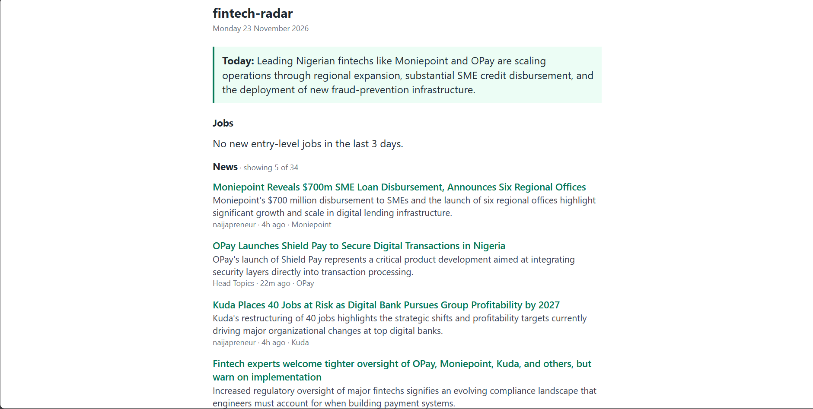

# fintech-radar

A daily email for an aspiring fintech engineer in Nigeria: new entry-level jobs and the day's most useful fintech news, ranked by AI, in a two-minute read.

It runs itself on GitHub Actions every day at about noon Lagos time. There is no server, no website and no database.



## Honest notes

- **AI sees headlines only.** Gemini ranks the headlines and writes one "why it matters" line for each, told to use only facts in the headline. It never reads the articles, so treat that line as a hint and the headline and link as the source.
- **If the AI fails, the email still comes.** It falls back to the newest headlines and says so at the bottom.
- **Job coverage is partial.** Jobs come from companies with a public job-board feed this project can read: Moniepoint (Greenhouse), Kuda and PiggyVest (Workable). Paystack's old Greenhouse board is closed; OPay, PalmPay, Flutterwave and Interswitch had no public feed when checked; Cowrywise uses Breezy, which isn't supported yet; Carbon hasn't been checked.
- **"Entry level" is a rule of thumb:** a board's own level field when it has one, otherwise no seniority words (senior, lead, head, manager...) in the title.
- **Only public data leaves your machine.** Headlines go to Gemini's free tier, which Google may use to improve its products. Your email address, app password and API key live in GitHub Secrets or a local `.env` that is never committed.

## Features

- **Jobs first:** entry-level roles in Lagos, Abuja/FCT or remote in Nigeria, first posted in the last 3 days, one per role
- **News:** Google News for 10 Nigerian fintechs from the last 24 hours, duplicates merged, the top 5 chosen and explained by Gemini, plus a one-line "Today:" summary
- **Never silently broken:** a feed or board that fails is named in the email footer and the run log; the run turns red (and GitHub emails you) only if the email itself can't be sent
- **Gemini retries:** busy or network errors are retried after 10s and 30s
- **Preview mode:** `python -m radar` writes `preview.html` and sends nothing
- **Everything is a setting** in `config.toml`: companies, section sizes, the AI model, job boards, places and seniority words
- **No third-party Python packages**: only the standard library

## How it works

```
Google News RSS ─┐
                 ├─► filter & merge ─► Gemini ranks news ─► HTML email ─► Gmail
Job boards ──────┘   (recent, Nigeria,   (falls back to
(Greenhouse,          entry level)         newest if busy)
 Workable)
```

| File | What it does |
|---|---|
| `radar/news.py` | Google News RSS per company, last 24 hours, duplicate headlines merged |
| `radar/jobs.py` | Greenhouse and Workable boards; Nigeria, entry level and age filters |
| `radar/ai.py` | One Gemini call a day; reply checked strictly; retries |
| `radar/digest.py` | Builds the email from sections; all outside text is HTML-escaped |
| `radar/emailer.py` | Gmail over SSL; reads `.env` |
| `radar/cli.py` | Puts it together: preview or `--send` |
| `.github/workflows/digest.yml` | The daily schedule |

Parsing and filtering are pure functions. Network, email and AI calls are swappable, so all 204 tests run offline against saved real responses in `tests/fixtures/`.

## Settings: `config.toml`

Part of the real file, to show what the settings look like. Edit the real `config.toml` rather than copying this.

```toml
[digest]
max_jobs = 5   # 0 hides a section
max_news = 5
max_regulation = 2   # reserved for the planned CBN section
max_events = 3       # reserved for the planned events section

[ai]
model = "gemini-3.1-flash-lite"   # check it exists and is free in Google AI Studio

[jobs]
boards = [
  { company = "Moniepoint", source = "greenhouse", id = "moniepoint" },
  { company = "Kuda", source = "workable", id = "kuda" },
]
max_age_days = 3
places = ["Lagos", "Abuja", "FCT", "Remote"]

[[companies]]
name = "Kuda"
region = "nigeria"
search = '"Kuda" bank'   # optional: narrows the news search
```

## Run your own copy

1. **Fork** this repo.
2. **Gmail:** turn on 2-Step Verification, then create an [app password](https://myaccount.google.com/apppasswords).
3. **Gemini:** create a free API key in [Google AI Studio](https://aistudio.google.com/api-keys).
4. In your fork: **Settings → Secrets and variables → Actions**, add `GMAIL_ADDRESS`, `GMAIL_APP_PASSWORD` and `GEMINI_API_KEY`.
5. **Actions** tab → enable workflows → **Daily digest** → **Run workflow** to test it.

The email goes to `GMAIL_ADDRESS`. Running locally, you can send it elsewhere with `DIGEST_TO` in `.env`; the workflow doesn't pass that setting yet.

## Run locally

Python 3.13 (3.11+ works).

```powershell
python -m venv .venv
.venv\Scripts\Activate.ps1
```

Create `.env` (it's in `.gitignore`):

```
GMAIL_ADDRESS=you@gmail.com
GMAIL_APP_PASSWORD=abcd efgh ijkl mnop
GEMINI_API_KEY=your-key
# DIGEST_TO=someone@example.com   (optional: send somewhere other than GMAIL_ADDRESS)
```

```powershell
python -m radar          # writes preview.html, sends nothing
python -m radar --send   # sends the email
```

Without `GEMINI_API_KEY`, the email still works with the newest headlines.

## Run the tests

```powershell
pip install pytest
python -m pytest
```

Every pull request runs the tests on GitHub Actions and gets a CodeRabbit review; `main` is protected.

## Roadmap

- CBN circulars and regulation section
- Hackathons and events section
- More job boards (Cowrywise on Breezy once it posts jobs; Paystack's new board)
- Wider Africa, then international companies
- AI ranking for jobs, not just news

## Credits

Inspired by an "AI news aggregator" tutorial idea, rebuilt from scratch around fintech careers in Nigeria. News from Google News RSS; jobs from companies' public Greenhouse and Workable boards; ranking by Google Gemini.

## License

MIT. See [LICENSE](LICENSE).
